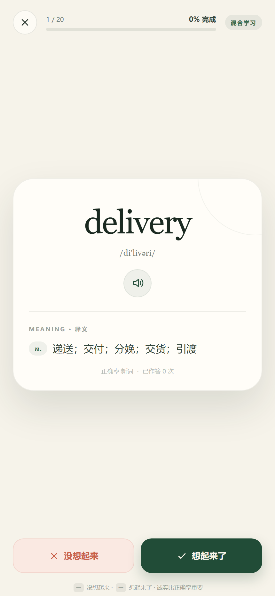
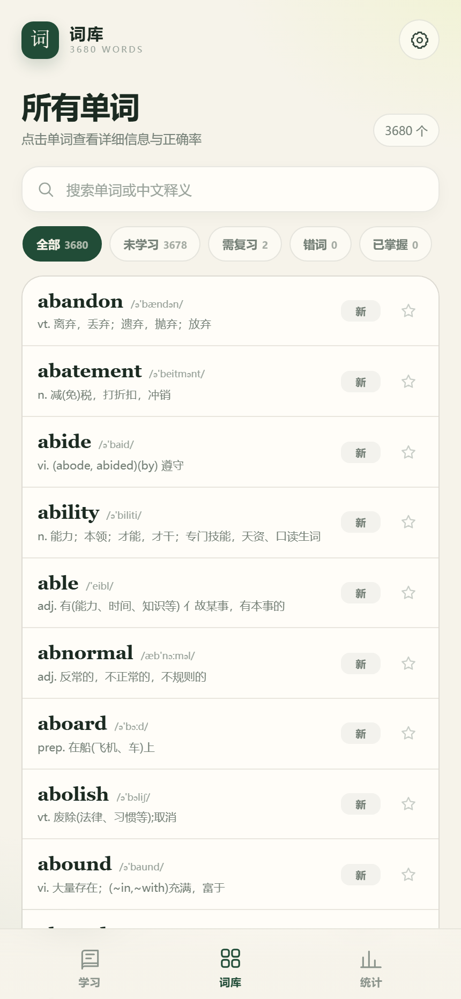
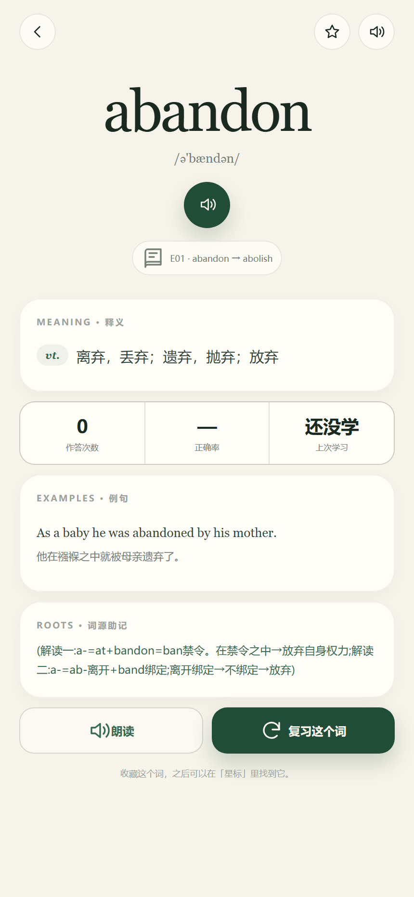
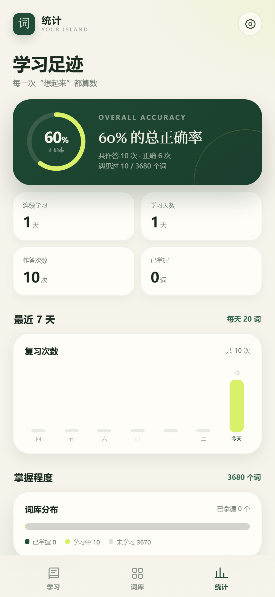

# 词屿 · Word Isle

把释义藏起来，点一下再出现。记录每一次答对与答错，看见自己的正确率。

> 想在 iPhone 17 Pro 上直接运行？不想用 GitHub 的话看 **[INSTALL-WITHOUT-GITHUB.md](INSTALL-WITHOUT-GITHUB.md)**：同一 Wi-Fi 本地服务器 + Netlify 拖拽上传，两种办法都不需要 GitHub、不需要 Mac。
>
> 想用 GitHub Pages 或安装原生 IPA，看 [INSTALL-ON-IPHONE.md](INSTALL-ON-IPHONE.md)。

这是一套可以直接在 iPhone 上使用的单词本 App，包含两种形态：

- **`wordisle/`**：iPhone 优先的 PWA（网页 App），Safari 打开后「添加到主屏幕」即可全屏使用，支持离线缓存、朗读、学习统计。
- **`ios/WordIsle.xcodeproj`**：原生 SwiftUI 工程，在 Mac 上用 Xcode 打开、签名后安装到 iPhone，也可以进一步上架 App Store。

词条来自 `5500词++E1-63汇总.pdf`，清洗、去重后共 **3,680 个词条**，包含音标、词性、中文释义、例句和词源助记（有则显示）。

## 预览






---

## 一、最快用起来：在 iPhone 上打开网页版

### 1. 在 Windows 上启动本地服务器

双击 `wordisle/start-server.bat`，或在 `wordisle` 目录运行：

```powershell
python -m http.server 8137 --bind 0.0.0.0
```

然后在电脑上打开 `http://127.0.0.1:8137/` 检查是否正常。

### 2. 让 iPhone 和电脑连同一个 Wi-Fi

在 Windows 命令提示符运行 `ipconfig`，找到「IPv4 地址」，例如 `192.168.1.23`。

在 iPhone Safari 地址栏输入：

```
http://192.168.1.23:8137/
```

### 3. 添加到主屏幕

在 Safari 点「分享」→「添加到主屏幕」→「添加」。

之后从桌面打开「词屿」，它会以接近全屏的方式运行。学习记录保存在 iPhone 本地。

> 说明：局域网 HTTP 环境下，Safari 的 Service Worker 可能不启用，所以首次打开需要电脑服务器开着。若把 `wordisle/` 部署到 GitHub Pages、Netlify、Vercel 等 HTTPS 静态站点，再添加到主屏幕，就能完整离线使用。

---

## 二、原生 iOS 工程（需要 Mac）

1. 用 Xcode 15 或更高版本打开 `ios/WordIsle.xcodeproj`。
2. 选择 `WordIsle` target → `Signing & Capabilities`：
   - 选择你的 Apple ID Team；
   - 如果 Bundle Identifier 冲突，改成自己的，例如 `com.yourname.wordisle`。
3. 连接 iPhone，选择真机，点 Run。
4. 免费 Apple ID 也可以安装到自己的手机（有效期 7 天，到期重装）；上架 App Store 需要 Apple Developer Program。

工程已经包含：

- `vocabulary.json`（3,680 个词条，随 App 打包，离线可用）
- AppIcon（1024 + 各尺寸）
- 学习卡片、释义隐藏、正确/错误记录、正确率、词库搜索筛选、星标、统计图表、单词详情、AVSpeechSynthesizer 朗读
- 本地持久化（UserDefaults）

最低系统版本：iOS 17。

---

## 三、功能说明

### 学习卡片

- 默认只显示单词和音标，**含义完全隐藏**。
- 轻点卡片（或点「查看释义」）出现释义、词源和例句。
- 出现后选择「没想起来 / 想起来了」，记录一次作答。
- 每个词独立统计作答次数、正确次数、正确率、上次学习时间。
- 一组结束显示本组正确率、用时、错词列表。

### 词库

- 3,680 个词条，支持英文单词、音标、中文释义搜索。
- 筛选：全部 / 未学习 / 需复习 / 错词 / 已掌握 / 星标。
- 点击单词进入详情：音标、词性、释义、例句、词源、正确率、朗读、复习这个词、星标。

### 统计

- 总正确率、作答次数、连续学习天数、学习天数、已掌握词数。
- 最近 7 天复习柱状图。
- 掌握程度分布（已掌握 / 学习中 / 未学习）。
- 正确率最低的词，点击直达详情。

### 朗读

- 网页版：Web Speech API（Safari 内置英语语音）。
- 原生版：AVSpeechSynthesizer，`en-US` 语音。

### 设置

- 每组 10 / 20 / 30 个词。
- 每日目标 10 / 20 / 30 / 50 个词。
- 揭晓时自动朗读。
- 清空学习记录、导出 / 导入进度（网页版）。

---

## 四、数据说明

- 源 PDF 共 370 页，前 14 页文本可直接读取，后续页面的中文字体使用了特殊编码，直接复制会乱码。
- 处理方式：使用 PDFium 提取英文、音标和页码，使用 Windows 中文 OCR 识别后续页释义，再按词条对齐、清洗、去重。
- PDF 中大量单词在不同课次重复出现；去掉重复后得到 3,680 个唯一词条。
- OCR 难免有少量字形误识别（例如个别生僻字、数字），释义以「能读懂、可学习」为目标，未逐字人工校对。若你希望我继续逐词校对某一部分，可以指出范围。

---

## 五、文件结构

```
wordisle/
  index.html
  css/style.css
  js/app.js
  data/vocabulary.json
  manifest.webmanifest
  sw.js
  icons/
  start-server.bat
ios/
  WordIsle.xcodeproj/
    project.pbxproj
    xcshareddata/xcschemes/WordIsle.xcscheme
  WordIsle/
    WordIsleApp.swift
    Models.swift
    Theme.swift
    Speech.swift
    HomeView.swift
    StudyView.swift
    LibraryView.swift
    StatsView.swift
    WordDetailView.swift
    SettingsView.swift
    Resources/vocabulary.json
    Assets.xcassets/
```

---

## 六、常见问题

**Q：为什么双击 `index.html` 打不开？**  
A：网页版通过 `fetch` 读取 JSON，`file://` 协议会被浏览器拦截。请用本地服务器打开（见上文）。

**Q：iPhone 上朗读没有声音？**  
A：先点一下页面任意按钮，再用喇叭按钮触发；iOS 要求语音由用户手势启动。检查侧边静音键和音量。

**Q：数据会丢吗？**  
A：记录保存在浏览器 `localStorage` 或 iOS `UserDefaults`。清理 Safari 网站数据、删除 App 会丢失。网页版可在设置里导出备份。

**Q：想上架 App Store？**  
A：在 Xcode 里配置 Team、Bundle ID、App 图标和隐私信息，Archive 后通过 App Store Connect 提交。App 不收集网络数据，语音在本机合成。
